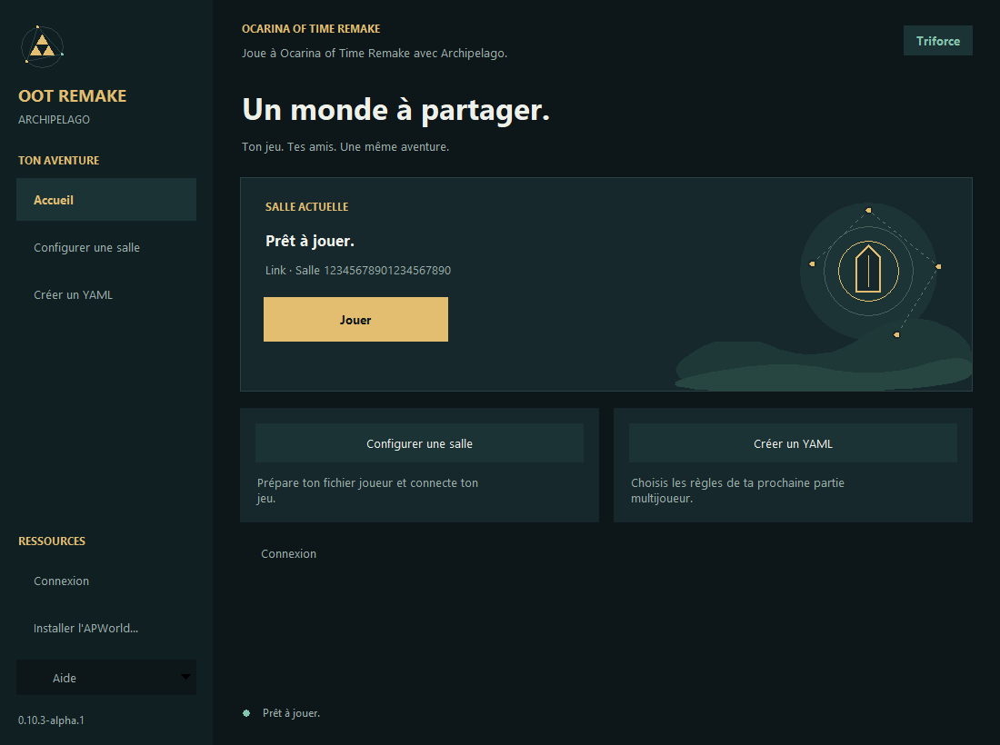

# Ocarina of Time Remake × Archipelago

Play Ocarina of Time Remake in an Archipelago multiworld with a single Windows application. It prepares the mod, manages the connection and launches your compatible game host.

**Current release: 0.10.4-alpha.14.** Held item models retain their native body poses and display heights; the Master Sword has a dedicated presentation pose.
Dungeon names, YAML import, runtime and updater fixes remain included;
see the [update notes](docs/RELEASE-NOTES-0.10.4-alpha.14.md).
The 0.10.4 selective upstream integration adds
current AP access rules, 17 physical sources and optional gameplay, cosmetic
and difficulty controls. See [what is adapted and how it is validated](docs/UPSTREAM-INTEGRATION.md).
Existing native 0.10 rooms remain supported. New sources and options require
the matching APWorld and a newly generated room with its own save.

**[Download the Windows launcher · 0.10.4-alpha.14](https://github.com/RAjeux/OOT-Remake-Archipelago/releases/download/v0.10.4-alpha.14/OOT-Remake-Archipelago-0.10.4-alpha.14.exe)** · [Release page](https://github.com/RAjeux/OOT-Remake-Archipelago/releases/tag/v0.10.4-alpha.14) · [Installation en français](docs/INSTALLATION.fr.md)

> **Use the native 0.10 release above.** The discontinued **0.11/0.12 Full-network experiment** has a higher number but a different player-file format. Its `.apootrr` files are not converted by this launcher. If you came from Full, export a fresh YAML with the current editor, generate a new room with the current APWorld and keep the old saves separate.

[Play](#play) · [Create a room](#create-a-room) · [Installation guide](docs/INSTALLATION.md) · [Compatibility](docs/PORT-COMPATIBILITY.md) · [Contribute](CONTRIBUTING.md)

## Play

You need:

- **Windows x64** and your own **version 1.1.1 game files**.
- A working **Triforce installation with its build tools**. Start with the [official Triforce setup guide](https://triforceproject.com/#install) if you have not built and launched the base game yet. Hookshot 3.0.1 is an [experimental alternative](docs/PORT-COMPATIBILITY.md#hookshot-setup).
- **Your `.apootrr` player file**, the room address and any room password from your organizer.

Keep the downloaded EXE wherever you prefer. Python, Node.js and the AP client are included; the compatible OOTRR 0.8.1 builder is downloaded when first needed. A player joining an existing room does **not** need to install Archipelago or an APWorld separately. No Nintendo game files are supplied.

1. Open the launcher and choose **Set up a room**. Select **your `.apootrr`**, then **Game host** and the game folder if it was not detected.
2. Enter the **room address** and password if required. Choose **Install and prepare** and wait for preparation and any required host build to finish.
3. Choose **Play**. Zelda connects from the title screen. For a new room, create a save dedicated to that room.

For later sessions, open the same launcher and choose **Play**. You can close it while Zelda is running. **Connection** changes the prepared room's address and password without a console; the in-game AP menu remains available. See the [complete installation guide](docs/INSTALLATION.md) and [connection guide](docs/CONNECTION-WINDOW.md).

## Create a room

Each Zelda player chooses their settings; one organizer generates the multiworld:

1. **Each Zelda player:** choose **Create YAML**, enter a unique player name, open **Choose settings…**, apply your choices and **Save YAML**. Send that `.yaml` to the organizer. The editor supports English and French search and keeps YAML keys stable.
2. **Organizer:** install [Archipelago](https://github.com/ArchipelagoMW/Archipelago/releases) **0.6.7 or later**; generation is tested with **0.6.8**. In this OOT Remake launcher, choose **Install APWorld** and select that Archipelago installation. Restart Archipelago. This installs the world and its generation runtime for the current Windows account.
3. **Organizer:** collect all players' YAMLs and generate the room **locally** with Archipelago. This is a custom APWorld; the public website generator does not include it. Host the generated room locally or upload its output to [Archipelago hosting](https://archipelago.gg/uploads).
4. **Organizer → each Zelda player:** send **that player's generated `.apootrr`**, the room address and any room password. The player then follows [Play](#play).

The launcher does not generate or host the multiworld. See the [organizer instructions](docs/INSTALLATION.md#organizer-generate-and-host) and [official Archipelago setup guide](https://archipelago.gg/tutorial/Archipelago/setup_en).

## Files and their roles

| File | Purpose | Who uses it? |
| --- | --- | --- |
| `OOT-Remake-Archipelago-0.10.4-alpha.14.exe` | The desktop launcher; includes the APWorld and runtimes. | Zelda players and the organizer. |
| `Player-name.yaml` | A player's settings **before generation**. | Player sends it to the organizer. |
| `ootrr_remake.apworld` | The custom game integration loaded by Archipelago's generator. | Organizer installs it with this launcher's **Install APWorld** action. |
| `AP_123456_P1_Link.apootrr` | Generated data for **one Zelda slot in one room**; filename shown as an example. | That Zelda player selects it in **Set up a room**. |

Changing a YAML after generation does not change the existing room. A new room needs its own `.apootrr` and dedicated save.

To reuse a configuration, open **Create YAML → Import YAML…**, select your `.yaml` or `.yml`, then **Choose settings…**. The player name and supported settings are loaded. Weighted values, additional Archipelago options and untouched settings are preserved; use **Replace** to edit a weighted or otherwise protected value. **Save YAML** proposes a separate `-modified.yaml` copy. Older native settings codes are decoded, and unsupported legacy settings are reported before conversion. See [importing an existing YAML](docs/INSTALLATION.md#reuse-an-existing-yaml).

## Compatibility and current limits

| Host | Current scope |
| --- | --- |
| **Triforce, Windows x64** | Main installation route. Triforce **0.8.4** has private save-loading, NPC/shop reward and pause/loading DeathLink regression coverage; **0.8.3** also has title-screen connection/reconnect and Bow/rupee receipt checks. Setup checks the host's tools and source hooks. |
| **Hookshot 3.0.1, Windows x64** | Experimental adapter requiring its matching original tools and retained build files. Other revisions are rejected. |
| **Fritchii 5.8.4** | RomFS overlay loading was tested; **there is no emulator AP gameplay backend**. |
| Other hosts or Linux | Not supported by this installer. |

This remains an **alpha**. The expanded catalogue has automated generation and resource coverage, but has not been manually completed in the game. New difficulty settings remain experimental. Longshot is an internal prototype, not a supported launcher host. [Release validation](docs/UPSTREAM-VALIDATION.md) and [port compatibility](docs/PORT-COMPATIBILITY.md) distinguish observed gameplay from automated checks.

## Updates and saved games

Use **Help → Check for launcher updates**, then **Update available → Install and restart** when a replacement has downloaded. The optional APWorld update is for the computer generating rooms. See [updating the launcher and APWorld](docs/UPDATING.md).

**Continue an existing native 0.10 room:** update the launcher and keep its `.apootrr` and save. If the launcher requests preparation, close Zelda and its builder, then prepare the **same player file** again. Its generated catalogue, settings and placements remain unchanged. Existing native 0.10 YAMLs remain supported.

**Use the 0.10.4 additions:** the organizer installs the matching APWorld, restarts Archipelago and generates a new room. Use its new `.apootrr` and a dedicated save. Updating the launcher or APWorld does not add checks or options to an existing room. Full 0.11/0.12 files remain a separate discontinued format.

Profiles, connection preferences, downloaded tools and saves live in `%LOCALAPPDATA%\OOTRR-Archipelago`, outside the EXE. Hookshot uses a separate `hosts\hookshot` namespace. Moving or replacing the launcher keeps this data; switching hosts does not transfer a save or item history. Changing settings or enabling new sources requires a newly generated room.

## What the mod does

A chest containing an item for Zelda shows and grants the native item assigned by Archipelago. A chest containing another player's item shows an AP medal and sends the item to that player. The chest's previous local reward is not granted a second time.

Enabled network sources include supported chests, ordinary shop purchases and special deals, Skulltulas, NPCs, songs, dungeon rewards, adult trades, cows, merchants, Scrubs, minigames, boss hearts, ground pickups and destructibles. Only selected supported sources enter the room. Newly generated 0.10.4 rooms have **185 checks by default**, with tested broad coverage reaching **1,229 including the optional Master Sword**. The count depends on the selected options; older rooms retain their original catalogue.

Items from other worlds are delivered in order while a save is active, using the game's effects. Items sent while Zelda is closed remain on the server and are recovered after reconnection. Each grant and its received-item index are committed together; save before quitting normally.

In a prepared `all_locations` room, loading an older save also restores previously checked AP sources from the room journal and server history. Your reward is granted once to that save; another player's reward only restores the completed source, without sending it again. Fixed or unselected native rewards follow the loaded save and have no additional AP history. Existing rooms retain the restoration scope of their own generated catalogue.

Archipelago fills the selected sources without a general Zelda recipient quota. Explicit placement choices still apply: dungeon-only keys/maps remain in the recipient's Hyrule, while keysanity can send them to another game. Song-only and end-of-dungeon pools can exchange compatible rewards between Zelda players. Native filler-only guards protect 35 possible sources, including 23 uncertain Skulltulas: they cannot hold progression from any game or Zelda tokens. See [items, checks and saves](docs/ITEMS-AND-SAVES.md).

Major received items use the game's native turn toward the player camera and item presentation pose. Ordinary pickups retain their native central display and sounds.

New receipts and older-save restorations wait for normal player control. Crawling, fishing, climbing, swimming, combat, active events and pause defer delivery; unknown actions also defer it. Paused or busy DeathLink states retain a pending death until normal control returns. Triforce also observes native inventory pauses while Link's callbacks are suspended and invalidates pending deaths at a loading boundary. The independent pause observer has gameplay coverage on Triforce 0.8.4; Hookshot retains its existing movement-based gate. See [delivery safety and validation limits](docs/DELIVERY-SAFETY.md).

Reprepared adult-trade rooms silently recover remote quest items which a completed exchange has already consumed. The corresponding check and its personal reward still recover normally. A DeathLink packet from a replaced connection is discarded. See the [stability and update notes](docs/STABILITY.md) for the targeted story fixes and validation scope.

Every non-Off `shuffle_shops` mode includes **all 64 purchases across eight shops**, including ordinary goods. `shuffle` mixes the native stock; `deals_1` through `deals_4` add special deals to the native pool and price layout, and `random_deals` rolls zero to four per shop. AP then fills the selected checks. These choices do not force foreign items or reserve Kokiri for another player. Shopsanity Prices controls the special-deal price layout. Old rooms retain their original shop selection.

`shops_always_open: true` keeps the eight item shops and the Happy Mask Shop open by day and night. Quest requirements still apply. Minigames keep their normal hours; this option is separate from the day/night cycle.

Archipelago reserves `random` (and the Random? control) for choosing a whole option value at random, which can select Off or another shop mode. Choose **Random Deals** explicitly for a variable number of deals per shop. The APWorld translates `random_deals` to OOTRR's native `random` value; native settings strings keep their original format.

`death_link: true` shares deaths with other DeathLink participants. A remote death waits for an active event, such as a purchase or item receipt, to finish.

`adult_trade_shuffle: true` replaces the adult trade rewards with AP items and puts the ten quest items in the multiworld. Talk to the appropriate NPC while owning their requested item; hidden items in the shared inventory slot are accepted automatically, and other owned trade items are retained. This mode starts with a hatched Pocket Cucco, disables trade-item expiry and removes the final three-day wait. It requires `shuffle_rewards: supported` and a newly generated room. The old additive `shuffle_trade_checks` control has been removed from new YAMLs; previously generated rooms retain their original behavior. See the [adult trade guide](docs/ADULT-TRADE-REWARDS.md).

`shuffle_master_sword: true` puts the Master Sword in the multiworld and replaces its first pedestal grant with an AP reward. Time travel and Rauru's separate reward remain available; the dungeon-reward setting controls whether his reward is shuffled. The default is `false`, retaining the native sword. This option needs a newly generated room and save; it does not change an existing room's sword. See the [Master Sword guide](docs/MASTER-SWORD.md).

For all Gold Skulltulas, choose **All 100 native sites** (`shuffle_skulltulas: matched`). **44-site subset** retains the `pinned` key; `off` leaves them unchanged. All selected sites become checks, including the filler-only sites. Collect the reward to complete its check; killing the enemy or receiving a token does not complete it. See the [Gold Skulltula guide](docs/GOLD-SKULLTULAS.md).

The app, settings labels, YAML comments and mod follow the known game language: French uses French text, and other languages fall back to English. YAML keys remain unchanged. Other players' names, chat and foreign item names retain their server wording. Developer documentation uses English.

Restart the game after changing its language. Both translations are installed together, so changing language does not require generating a new seed.

The shared schema exposes **94 native OOTRR settings and 36 integration controls**: 130 controls, with one engine and no duplicate generation mode. Disabled dependent controls show their requirements. Uncollected shuffled containers can be retried after reloading the area; breaking them alone never sends their check.

**Ground pickups and heart pieces** uses the native `shuffle_freestanding_items` setting. `off` and `pieces` are aliases that both shuffle supported heart pieces; `all` adds ordinary rupees and recovery hearts, while `dungeons` and `overworld` limit those extra pickups by area. Other heart pieces may come from separately controlled chests or NPCs.

The default closed forest keeps Mido's sword-and-shield requirement. **Deku Tree and forest access: Open** opens both the Tree and forest exit. **Skip introduction automatically** skips the opening movie and Link waking up. **Manual cutscene skipping** unlocks the existing skip action; it does not automatically remove every cinematic. These retain the 0.10 behavior.

Independently randomized sub-options are ignored while their parent setting is inactive. For example, a random fixed price does not affect a sale using Cheap prices. Active settings still follow their documented dependencies; Random? on every field can produce an invalid combination.

The [complete comparison of all 118 native settings](docs/SETTINGS-COMPATIBILITY.md) explains the 24 omitted native controls, including the replaced additive trade setting, unavailable native features, Silver Rupee delivery, AP-aware hints, chest sizes and location exclusions. Do not add omitted YAML keys expecting them to enable those features.

The [OoTR comparison](docs/OOTR-SETTINGS-COMPARISON.md) distinguishes the N64 randomizer's settings from those available in the remake. `bridge: open` provides the existing zero-reward bridge condition directly in the YAML.

New rooms use `reward_mode: all_locations`, `local_items: true`, and `items_handling=5`: personal items are granted physically, while the network supplies remote items and AP starting inventory. Older `all_chest_rewards` and `legacy_gear` rooms keep mode `7`. Generate a new room to change modes; do not edit an existing room's flags to convert it.

## Develop

Start with [CONTRIBUTING.md](CONTRIBUTING.md) for the contribution workflow and reporting guidelines. The [development guide](docs/DEVELOPMENT.md) covers environment setup, running the UI from source, packaging and rebuilding components. The [architecture guide](docs/ARCHITECTURE.md) maps the launcher, APWorld, native bridge and engine; [testing](docs/TESTING.md) describes checks and their limits.

Use English source messages with matching French translations. Preserve AP protocol IDs, compatibility paths and third-party notices. The [player guide](distribution/Guide.txt) is also available as plain text.

## Licenses and credits

Integration code is distributed under **GPL-3.0-or-later**, with separate licenses for third-party components. Archipelago artwork retains its own terms, including **CC BY-NC 4.0** for the colored icon and its adaptations. The title lettering is rendered for this project using the Cinzel font under OFL 1.1. See [LICENSE](LICENSE), [NOTICE](NOTICE), and [REFERENCES.md](REFERENCES.md).
