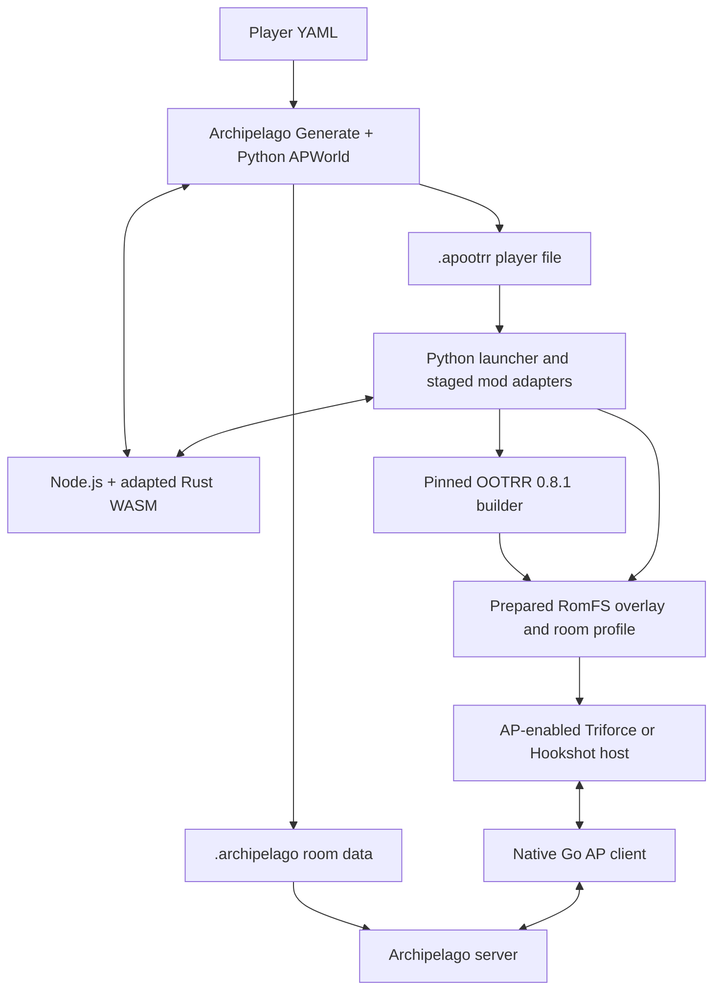

# Architecture and compatibility contracts

This repository connects the existing OOTRR randomizer to Archipelago. The
adapted engine selects a native seed and proves access to its enabled sources.
The APWorld exports those sources and items to Archipelago's multiworld fill.
The launcher prepares the resulting room for a supported native game host.

Start with [development setup](DEVELOPMENT.md) and [testing](TESTING.md). Player
installation is described in the [README](../README.md). Component origins and
retained notices are recorded in [REFERENCES.md](../REFERENCES.md).

## Source ownership and entry points

| Area | Responsibility | Where to change it |
| --- | --- | --- |
| APWorld, integration code | AP options, regions, item pool, placement restrictions, slot data and player files | [apworld/ootrr_remake/](../apworld/ootrr_remake/) |
| Desktop application, integration code | Tk UI, settings editor, setup, updates and local room profiles | [client/ootrr_triforce/](../client/ootrr_triforce/); start at `app_window.py` and `install_service.py` |
| Mod adapters, integration code | Replace native rewards, build receipt/recovery events, maintain resource sizes and host hooks | The same Python package; `player.py`, `medallions.py`, `network_rewards.py`, `receipt_events.py`, `restoration.py`, `native_setup.py`, `hookshot_setup.py` |
| Native AP client, integration code | WebSocket connection, synchronized history, durable checks, DeathLink and connection controls | [native/](../native/), principally the Go files |
| Host bridge and embedded menus, integration code | Read game state on its thread, request native events, expose the Go client to supported hosts | `native/ootrr_archipelago.inc`, `ootrr_ap_items.inc`, `ootrr_ap_menu.inc`, `ootrr_ap_hookshot*.inc` |
| Adapted OOTRR fork | Seed generation, access proof, selected source export, native resource operations | [moteur/ootrr-ap/randomizer/](../moteur/ootrr-ap/randomizer/), including `core/src/bin/ootrr_ap.rs` |
| Upstream-derived resource libraries | BYML, SARC, BFEVFL, AINB and other game formats | `client/oot_rando/`, `client/ainb/`, `client/evfl/`; retain their existing notices |
| Vendored dependencies | Third-party Python, Go and Rust implementations | `client/websockets/`, `native/vendor/`, `moteur/ootrr-ap/vendor/`; update deliberately rather than applying integration-wide edits |
| Reference host source | Test fixtures and provenance for the supported bridge | [references/triforce/](../references/triforce/); this is not the player's complete SDK |

The Rust folder contains both upstream work and integration changes. Its
upstream README and CONTRIBUTING file describe OOTRR; the root
[CONTRIBUTING.md](../CONTRIBUTING.md) describes contributions to this integration.
Historical names such as `ootrr_triforce`, `moteur` and `nx2navi` remain part of
the source layout and compatibility paths.

## Generation and preparation

1. The APWorld translates supported YAML values into native settings.
   `generate_early()` calls `engine.run_engine("generate", ...)`. Node runs the
   packaged `engine.wasm`, which returns the native `seed_file`, enabled source
   descriptors, the current access graph and the historical donor proof/waves.
   New AP rooms evaluate the graph's actual regions, events, ages and item
   predicates; they do not use the donor waves to order the final fill.
2. The APWorld creates regions and items from that result. Archipelago performs
   the final multiworld placement, subject to selected song/dungeon scopes and
   source safety rules. The engine's original donor reward is distinct from
   the final AP item at that check.
3. Generation writes the room's `.archipelago` data and each Zelda player's
   `.apootrr`. The latter carries the native seed, exact enabled check set,
   source schema, room/player identity and feature flags. It is an input to
   preparation, not a new randomizer configuration to reroll at launch.
4. `player.read_manifest()` validates the player file. Setup creates a room
   profile, builds the native base overlay with the compatible OOTRR 0.8.1
   builder, and applies the integration's Rust/Python passes to staged files.
   `medallions.prepare()` subsequently binds the actual AP reward roster to
   physical rewards and recovery routes.
5. Resource writers preserve native continuations and update event dependency
   registrations and allocation tables when a resource grows. The completed
   overlay is installed only after staging succeeds. Host adapters validate
   and patch the selected SDK, then rebuild its executable/renderer as needed.

`engine.cjs` is the Node/WASI entry point. `engine.py` handles subprocesses and
Windows path constraints. The single Windows application includes Node; the
computer running Archipelago generation needs Node 22 or 24 available as
documented in [TESTING.md](TESTING.md).

New rooms use source schema 2 and a versioned `features` envelope. The reviewed
rule bundle lives in `moteur/ootrr-ap/data/ap_logic_v2/`; it does not replace the
0.8.1 constructor's data or seed format. Additional source identities are
append-only. Post-constructor `features` and `cosmetics` passes apply the opted-in
native changes; the shared `access_logic.py` evaluates the exported rules in AP.
Feature choices and the graph salt the room identity. Files without these
extensions keep their historical preparation and access paths.

The `IsTreasureBoxOpen.<actor>` keys watched by the native client must be actual
saved Bool keys, not only a Struct member pointing to a differently named spare.
`cursor_resource.register_chest_flags()` registers and connects the six newly
converted frozen chests while preserving native aliases and saved data. The
client reads those same canonical hashes on every supported native host.

See [selective upstream integration](UPSTREAM-INTEGRATION.md) for the retained
constructor boundary, source import tools and features intentionally not copied.
The [Longshot source prototype](LONGSHOT-PROTOTYPE.md) has its own experimental
scheduler adapter and remains unavailable in the public host selector.

## APWorld packaging and generated artifacts

`apworld/ootrr_remake/` is deliberately not a self-contained copy of the client
package in the checkout. [tools/build.py](../tools/build.py) defines
`WORLD_FILES`: shared modules and resources copied from
`client/ootrr_triforce/` into the built APWorld. `tools/build_app.py` uses that
same list when embedding an APWorld in the Windows application.

For example, edit `client/ootrr_triforce/catalog.py` to change the shared
catalogue. Do not create a competing `apworld/ootrr_remake/catalog.py` or edit a
file inside an already built `.apworld`. Run the build/validation tools to
reassemble the package. New shared modules used by the APWorld must be included
in `WORLD_FILES`.

| Artifact | Source and required follow-up |
| --- | --- |
| `client/ootrr_triforce/engine.wasm` | Build the adapted Rust `ootrr_ap` WASI binary; validate the freshly built engine before replacing the tracked artifact |
| `prebuilt/windows-x64/archipelago.dll` | Build `native/` with Go and an x64 cgo compiler; regenerate its matching `ootrr_ap_digest.h` and rebuild the host using it |
| `native/ootrr_ap_items.inc`, `ootrr_ap_trade.go` | Generated from frozen Python identities by `tools/generate_item_header.py` |
| `dist/*.apworld`, `.pyz`, `.exe` and release ZIP | Packaging outputs; rebuild from source rather than editing their contents |
| Native source/ID catalogues | `network_sources.json`, `network_ids.json` and legacy catalogues; changes require matching native export, validation and compatibility tests |

The executable's release `VERSION`, prepared-resource revision and native DLL
digest serve different purposes. A desktop-only update need not change a
room's resources or save. A receipt/resource fix may require preparing the
same room again. A DLL or host-hook change requires rebuilding the native host.
Keep those invalidation decisions explicit in a change.

## Runtime ownership and delivery

The C bridge is compiled into the supported host. It finds the enabled mod's
room marker, verifies the adjacent DLL's digest and starts the Go client. Go
owns the AP socket and network state; the C/game thread owns access to live game
objects. A connection can exist before the title screen, while item effects
wait for a loaded save and a safe player state.

| Interface/state | Owner and contract |
| --- | --- |
| AP `Connect`, `ReceivedItems`, `LocationChecks`, `Bounce` | Go client, communicating with the AP server |
| `AP_Next`, `AP_Applied`, `AP_Opened`, `AP_Restore`, DeathLink and connection exports | DLL C ABI consumed by the host; see [native/BUILD.md](../native/BUILD.md) and the exported functions |
| Physical item effect and source completion | Native event recipe selected during preparation |
| Received-item position | Saved GameData cursor `Archipelago.ReceivedIndex.<room-token>` |
| Completed exported checks | Saved location flags plus durable `native-checks.json` and server confirmation |
| Desktop/menu connection changes | The same Go client, via the embedded bridge or authenticated local controller |

The `items_handling` mode must agree with prepared reward behavior:

| Mode | Where personal local rewards are granted | AP history requested |
| --- | --- | --- |
| `all_locations`, `local_items: true` | By their physical native events | `5`: remote and starting items; omit own-world receipts to avoid a second grant |
| Older `all_chest_rewards` / `legacy_gear` paths | According to that room's released adapter | `7`: remote, own-world and starting items |

The Go client synchronizes the server's indexed history before enabling
delivery. The host requests the event for the next item at the save's cursor.
The event applies its native effect and advances that cursor in the game's
write queue before its save request. This local acknowledgement is not another
AP item send. Reconnection reconstructs history; it does not invent a separate
delivery position in a launcher settings file.

An accepted event stays pending until its result/cursor commits or the actual
gameplay context changes. Elapsed time or a paused player is not permission to
request the same item again. Receipts and restoration wait through constrained
actions. See [delivery safety](DELIVERY-SAFETY.md) for the native whitelist and
remaining lifecycle limits.

Physical checks are reported from completion flags, not merely from an enemy
death or broken pot. The check journal is monotonic across older saves and is
persisted before sending newly observed checks. On rollback:

- Network items replay from the older save's received-item cursor.
- A previously completed local AP check restores its personal reward and flags
  once to that save. A foreign reward restores only the used check state.
- Restoration does not advance the filtered network cursor or resend a foreign
  reward. Fixed/unselected native rewards retain ordinary save behavior.
- Completed adult exchanges reconcile spent quest items; their remote receipt
  replay can acknowledge a consumed token silently.

Progressive tiers, no-equipment ammunition and native bundle counts are part
of the recipe contract. A `Shop_*` bundle actor can supply a free native item
effect without executing a shop purchase. Do not replace such recipes with
direct stock writes or infer item ownership solely from their displayed model.

## Identity and format compatibility

`catalog.py` contains the released item/location identities. New source IDs are
appended through `network_ids.json`; existing IDs, names and saved flags keep
their meaning. `network_sources_schema: 1` supplies trusted physical/event
descriptors for newly generated native rooms. `tools/check_catalog.py` and
protocol fixtures guard those relationships. Display translations belong in
the language layer; canonical AP names and IDs remain unchanged.

The supported native 0.10 line uses a `.apootrr` with `seed_file` and the room's
generated catalogue. Older native files retain their original check scope and
preparation path. The superseded 0.11/0.12 experiment used
`generation_mode: full_network`, `full_format_version` and `full_patch` instead.
The shared extension, or a `protocol: 1` field, does not make these formats
interchangeable. Installing the matching current APWorld and generating a new
room is required; adding fields to an old Full file is not a conversion.

The bridge also depends on the supported game's 1.1.1 object layout and the
host SDK's validated hooks. Loading the RomFS on a new host does not supply
its AP runtime backend. A new port needs a researched game-thread integration,
native event dispatch, save/cursor handling and lifecycle validation. Consult
the [port compatibility matrix](PORT-COMPATIBILITY.md) before extending one.
